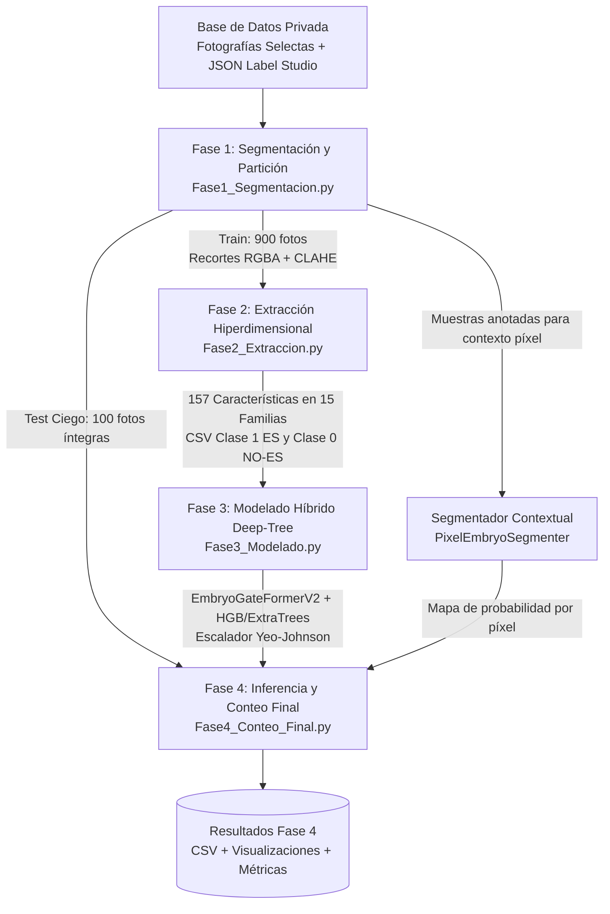

# Pipeline de Visión por Computadora para Segmentación, Modelado y Conteo Automatizado de Embriones Somáticos en Kalanchoe daigremontiana

> **Estado del Proyecto:** Fase 1 de Resultados Experimentales (Pre-publicación)  
> **Versión:** `v1.0.0-alpha`  
> **Disponibilidad de Datos:** Restringida (Base de datos privada en proceso de publicación científica)

---

## 1. Descripción General

Este repositorio contiene la implementación oficial del flujo de trabajo (*pipeline*) de visión por computadora, extracción hiperdimensional de características biofísicas y aprendizaje profundo tabular diseñado para la segmentación, clasificación y conteo automatizado de embriones somáticos (ES) en explantes foliares de *Kalanchoe daigremontiana*.

El presente lanzamiento documenta la **primera entrega de resultados**, liberando el código fuente de las cuatro fases que integran la metodología junto con los reportes cuantitativos de validación ciega obtenidos en la **Fase 4 (Conteo Final)**.

### Aviso de Confidencialidad y Anonimato de Datos
Debido a que la base de datos experimental original (**1,748 fotografías digitales** y sus anotaciones poligonales expertas generadas en Label Studio) forma parte de una investigación científica en proceso de publicación:
1. El directorio de imágenes crudas (`Fotografías selectas/`), el archivo de anotaciones (`.json`) y los cuadernos auxiliares de muestreo (`.ipynb`) han sido excluidos del repositorio público.
2. Los artefactos intermedios (`Fase 1 Segmentacion/`, `Fase 2 Extraccion/` y `Fase 3 Modelado/`) se mantienen privados para resguardar los recortes biológicos y las matrices de entrenamiento.
3. Únicamente se exponen los cuatro módulos principales de código (`Fase1` a `Fase4`) y los resultados consolidados de prueba en `./Fase 4 Conteo Final/`. El conjunto de datos será liberado tras la publicación oficial del manuscrito.

---

## 2. Arquitectura del Sistema y Flujo Metodológico

El sistema opera bajo un esquema modular de cuatro fases secuenciales que transforman las imágenes crudas y sus polígonos de entrenamiento en un detector y contador autónomo de domos embrionarios:



### Descripción Técnica de las Fases

#### Fase 1 — Segmentación y Partición de Datos (`Fase1_Segmentacion.py`)
* **`LabelStudioParser`:** Decodifica las coordenadas porcentuales de las etiquetas poligonales (`polygonlabels`) escalándolas a las dimensiones nativas de cada fotografía.
* **`EmbryoProcessor`:** Estandariza las condiciones de iluminación convirtiendo cada imagen al espacio CIELAB y aplicando ecualización adaptativa de histograma limitada por contraste (**CLAHE**, `clipLimit=2.0`, `tileGridSize=(8,8)`) únicamente sobre el canal de luminosidad ($L$) para no alterar la cromaticidad biológica. Posteriormente, genera una máscara binaria exacta del polígono sobre el canal Alpha (**BGRA**) y recorta estrictamente el *bounding box* de la biomasa en formato `.png`.
* **`DatasetManager`:** Separa el flujo aplicando un límite estricto (`train_limit=900`), destinando las primeras 900 imágenes a la extracción de recortes de entrenamiento (`1_train_features_ES`) y reservando las 100 imágenes restantes (`2_final_counting_Images`) para la evaluación ciega de conteo de extremo a extremo.

#### Fase 2 — Extracción Hiperdimensional de Características (`Fase2_Extraccion.py`)
* **`AdvancedBiologicalExtractor` & `HyperdimensionalOrchestrator`:** Ejecuta extracción multiproceso (`ProcessPoolExecutor`) sobre los recortes RGBA (aislando los píxeles internos mediante la máscara `alpha > 127`), calculando **157 descriptores matemáticos** distribuidos en **15 familias analíticas** (con sanitización estricta de 0 valores `NaN` o infinitos):

| Código | Familia Analítica | Nº Vars | Descriptores Extraídos |
| :--- | :--- | :---: | :--- |
| **F1** | `Geometria_Adimensional` | 5 | Excentricidad elíptica, razón de ejes, diámetro equivalente/eje mayor, razón radio inscrito (transformada de distancia $L_2$) a circunscrito y desviación del grosor interno. |
| **F2** | `Morfologia_Topologica` | 5 | Solidez, circularidad, convexidad y profundidad máxima/media de defectos de convexidad normalizados (muesca apical cotiledonar). |
| **F3** | `Momentos_Hu` | 7 | 7 momentos invariantes de Hu (transformación logarítmica con signo) sobre la silueta binaria. |
| **F4** | `Momentos_Zernike` | 25 | Momentos ortogonales de Zernike hasta grado 8 (`degree=8` vía `mahotas`) sobre intensidad interna enmascarada. |
| **F5** | `Descriptores_Fourier` | 10 | Primeros 10 armónicos de la FFT del contorno complejo centrados y normalizados invariantes a escala. |
| **F6** | `Complejidad_Fractal` | 2 | Dimensión fractal por *box-counting* sobre bordes internos de Canny y entropía de Shannon del histograma de distancias radiales al centroide. |
| **F7** | `Estadistica_Fotometrica` | 5 | Coeficiente de variación, asimetría (*skewness*), curtosis, entropía fotométrica e IQR normalizado. |
| **F8** | `Textura_Haralick_GLCM` | 26 | Media y rango pico a pico (`ptp`) de los 13 descriptores de co-ocurrencia de Haralick isotrópicos (`ignore_zeros=True`). |
| **F9** | `MicroTextura_LBP` | 18 | Histograma de patrones binarios locales uniformes (`radius=2`, `points=16`, `18 bins`). |
| **F10** | `Frecuencia_Gabor` | 8 | Respuesta media y desviación estándar isotrópica de un banco de filtros de Gabor ($\sigma \in \{1.5, 3.0\}$, $\lambda \in \{5.0, 10.0\}$, 4 orientaciones $\theta$). |
| **F11** | `Granulometria_Celular` | 4 | Decaimiento relativo de intensidad luminosa tras aperturas morfológicas elípticas multiescala ($3\times3, 5\times5, 7\times7, 9\times9$). |
| **F12** | `Densitometria_Optica` | 6 | Densidad óptica por Ley de Beer-Lambert ($OD = -\log_{10}(I/255)$), razón y diferencia de absorción núcleo-periferia, magnitud de gradiente de Sobel y rugosidad Laplaciana. |
| **F13** | `FitoEspectral_Invariante` | 12 | Cromaticidad pura normalizada, índices botánicos *Excess Green* ($ExG$), *Excess Red* ($ExR$), *Green-Red Vegetation Index* ($GRVI$), índice $\mathrm{NDI}_{\mathrm{Lab}}$ y razón de croma CIELAB núcleo/periferia. |
| **F14** | `Coherencia_Frontera_3D` | 14 | Alineación normal $\left|\cos(\theta)\right|$$ entre gradiente lumínico y campo de distancia, gradientes entre anillos histológicos (epidermis, córtex, meristemo), correlación de domo 3D, desplazamiento de centroide óptico y 7 momentos de Hu ponderados por densidad óptica. |
| **F15** | `Tensor_Hessiano_Venacion` | 10 | Autovalores ($\lambda_1, \lambda_2$) de la matriz Hessiana de 2do orden (*blobness* globular frente a nervaduras foliares, *structureness*, traza, determinante, anisotropía), razón interna de Otsu y densidad de bordes. |

#### Fase 3 — Modelado Híbrido e Interpretabilidad por Familias (`Fase3_Modelado.py`)
* **Prevención de Fuga de Datos y Preprocesamiento:** Agrupa los recortes según su fotografía de origen (`GroupShuffleSplit`, 90% entrenamiento / 10% validación) para garantizar que recortes de una misma hoja no compartan particiones. Aplica transformación paramétrica **Yeo-Johnson** (`PowerTransformer`) con respaldo en `StandardScaler` y acotamiento en $[-10, 10]$.
* **Arquitectura Neuronal `EmbryoGateFormerV2` (PyTorch):**
  1. *Tokenizadores Numéricos Periódicos (`PeriodicNumericalTokenizer`):* Codifica cada una de las 15 familias mediante proyecciones de Fourier aprendibles ($\sin/\cos$) y compuertas **SwiGLU** ($d_{\mathrm{model}}=64$).
  2. *Compuerta de Familia (`Family Gate`):* Módulo *Squeeze-and-Excitation* que pondera dinámicamente la relevancia de cada una de las 15 familias biológicas en cada predicción.
  3. *Fusión Tri-Ruta:* Combina en paralelo una **Ruta Atencional Inter-Familiar** (`TransformerEncoder` de 2 capas, 4 cabezales, token `[CLS]` + *Mean Pooling*), una **Ruta Profunda Residual** (`GatedResidualBlock` GRN) y una **Ruta Polinomial de Cruce Explícito** (`DeepCrossLayerV2` - DCNv2).
  4. *Cabezal Multi-Sample Dropout:* Promedia 5 ramas paralelas de *Dropout* ($p \in \{0.1, 0.2, 0.3, 0.4, 0.5\}$) entrenadas con **Binary Focal Loss** (`alpha=0.5`, `gamma=2.0`, `label_smoothing=0.02`), **Tabular Mixup** ($\alpha=0.2$) y optimizador `AdamW` con `CosineAnnealingLR` durante 150 épocas.
* **Sinergia Deep-Tree y Calibración:** Combina las probabilidades de `EmbryoGateFormerV2` (**55%**) con una rama experta de árboles (**45%**, conformada por **65% `HistGradientBoostingClassifier`** y **35% `ExtraTreesClassifier`**), calibrando el umbral óptimo de decisión $\tau^*$ que maximiza el F1-Score en validación.

#### Fase 4 — Segmentación Contextual, Detección y Conteo (`Fase4_Conteo_Final.py`)

La versión actual combina el clasificador de características por candidato (`EmbryoGateFormerV2` y su rama de árboles) con un segmentador contextual de píxeles y un escáner de contornos en la resolución de trabajo. La extracción de características de cada candidato se ejecuta en paralelo; la inferencia de los modelos se mantiene en CPU.

* **Gestión de recursos y compatibilidad:** limita los hilos de OpenCV y de bibliotecas numéricas, desactiva CUDA y usa hasta la mitad de los núcleos disponibles, con un máximo de seis trabajadores. Incluye un parche de compatibilidad en memoria para llamadas de OpenCV que reciben arreglos `float64`.
* **`PixelEmbryoSegmenter` — Segmentación contextual por píxel:** construye 12 mapas de características por píxel: luminosidad y cromaticidad relativas, índices `ExG` y `GRVI`, relieve DoG fino y de escala macro, rugosidad local, reflejo especular, distancia al borde del tejido y energía de gradiente. Estima una máscara del tejido vegetal para excluir el agar y entrena un `HistGradientBoostingClassifier` con píxeles positivos dentro de los polígonos anotados y negativos de tejido vegetal y fondo. El clasificador se guarda en `pixel_context_segmenter.pkl` y se reutiliza si ya existe.
* **`NativeContourEmbryoScanner` — Generación de candidatos:** calcula un mapa de probabilidad contextual sobre cada imagen y propone contornos mediante seis umbrales de probabilidad, segmentación morfológica, separación por `Watershed`, corte de protuberancias marginales y ventanas deslizantes multiescala. Los candidatos se recortan contra la máscara del tejido para evitar incluir el fondo de agar, se filtran por área, dimensiones, circularidad, solidez y probabilidad contextual, y se deduplican antes de extraer descriptores.
* **Extracción e inferencia híbrida:** para cada candidato se calculan los descriptores con `AdvancedBiologicalExtractor` y se predice con `EmbryoGateFormerV2`. Cuando están disponibles los modelos de árboles, su probabilidad conjunta se forma con `HistGradientBoostingClassifier` (65 %) y `ExtraTreesClassifier` (35 %); esta rama se combina con la red profunda en proporción 55/45.
* **Fusión final y supresión de duplicados:** `select_final_detections` combina la probabilidad del modelo de candidato (65 %) con la probabilidad contextual del píxel (35 %). Después aplica supresión de no máximos poligonal (NMS), umbrales de solapamiento y proximidad de centroides. La implementación limita el resultado a un máximo de siete detecciones por imagen y conserva una detección de mayor puntuación si ninguna supera el umbral de confianza configurado.
* **Calibración y evaluación:** calibra el umbral de confianza fusionada usando una muestra de hasta 30 imágenes de validación. La etapa 4A evalúa el reconocimiento de los embriones anotados en las imágenes de prueba; la etapa de conteo compara el número detectado con el conteo real por imagen.
* **Archivos de salida:** genera `reporte_conteo_100_imagenes.csv` con el nombre de la imagen, candidatos evaluados, conteo real, conteo predicho, error absoluto y error relativo. También guarda visualizaciones anotadas en `visualizaciones_conteo/`, con polígonos reales en verde y detecciones de IA en magenta.

Las métricas finales calculadas incluyen exactitud global de conteo basada en el error absoluto acumulado, porcentaje de imágenes con error de hasta un embrión, MAE, RMSE y coeficiente de determinación \(R^2\). Los valores concretos deben tomarse del reporte producido por la ejecución, no asumirse a partir de la descripción del método.

---

## 3. Estructura del Repositorio

```text
├── Fase 4 Conteo Final/
│   ├── reporte_conteo_100_imagenes.csv  # [PÚBLICO] Resultados detallados de conteo en las 100 imágenes de prueba
│   └── visualizaciones_conteo/          # [OPCIONAL] Primeras 25 imágenes de prueba con detecciones (GT vs IA)
├── Fase1_Segmentacion.py                # [PÚBLICO] Parser de Label Studio, mejora CLAHE y recorte RGBA
├── Fase2_Extraccion.py                  # [PÚBLICO] Extractor multiproceso de 157 características (15 familias)
├── Fase3_Modelado.py                    # [PÚBLICO] Red EmbryoGateFormerV2 + Ensamble HGB/ExtraTrees
├── Fase4_Conteo_Final.py                # [PÚBLICO] Detector de domos meristemáticos, NMS y conteo ciego
├── .gitignore                           # Reglas de exclusión para protección de la base de datos privada
└── README.md                            # Documentación técnica del proyecto
```

---

## 4. Entorno de Desarrollo y Dependencias

El proyecto fue desarrollado y validado en **Ubuntu Linux** con **Python 3.10+**. Los paquetes requeridos por los cuatro módulos son:

| Librería / Paquete | Versión Recomendada | Uso Específico en el Pipeline |
| :--- | :--- | :--- |
| `Python` | `>= 3.10` | Intérprete base y concurrencia con `ProcessPoolExecutor` |
| `opencv-python` | `>= 4.8.0` (compatible `4.11`) | Preprocesamiento CLAHE, contornos, Canny, Sobel, Gabor, DoG y NMS (Fases 1, 2 y 4) |
| `numpy` | `>= 1.24.0` | Álgebra matricial, FFT de Fourier y cálculo vectorial (Fases 1–4) |
| `pandas` | `>= 2.0.0` | Estructuración de matrices tabulares y exportación de reportes CSV (Fases 2–4) |
| `mahotas` | `>= 1.4.13` | Cálculo de Momentos Ortogonales de Zernike (F4) y Textura GLCM de Haralick (F8) (Fase 2) |
| `scikit-image` | `>= 0.21.0` | Extracción de micro-textura mediante `local_binary_pattern` uniforme (F9) (Fase 2) |
| `scipy` | `>= 1.11.0` | Estadísticos de orden superior (`skew`, `kurtosis`, `entropy`) y optimización (Fases 2 y 4) |
| `torch` (PyTorch) | `>= 2.1.0` | Arquitectura neuronal `EmbryoGateFormerV2` y `BinaryFocalLossWithLogits` (Fases 3 y 4) |
| `scikit-learn` | `>= 1.3.0` | `GroupShuffleSplit`, `PowerTransformer` (Yeo-Johnson), `HistGradientBoosting`, `ExtraTrees` y métricas (Fases 3 y 4) |
| `joblib` | `>= 1.3.0` | Serialización de escaladores, listas de características, umbral óptimo y modelos de árboles (Fases 3 y 4) |

Para configurar el entorno virtual e instalar todas las librerías necesarias:

```bash
python3 -m venv venv
source venv/bin/activate
pip install numpy pandas opencv-python mahotas scikit-image scipy torch scikit-learn joblib
```

---

## 5. Ejecución del Flujo de Trabajo

Si se dispone del conjunto de datos local (`./Fotografías selectas` y el archivo de anotaciones `.json` de Label Studio), el pipeline completo se ejecuta de manera secuencial con los siguientes comandos:

```bash
# Fase 1: Segmentar recortes RGBA de entrenamiento (900 fotos) y separar lote de conteo (100 fotos)
python3 Fase1_Segmentacion.py

# Fase 2: Extraer las 157 características de las 15 familias biológicas (Clase 1 y Clase 0)
python3 Fase2_Extraccion.py

# Fase 3: Entrenar EmbryoGateFormerV2 + co-ensamble de árboles y calibrar umbral óptimo
python3 Fase3_Modelado.py

# Fase 4: Ejecutar Test Ciego (Etapa 4A) y Conteo Final por detección de domos (Etapa 4B)
python3 Fase4_Conteo_Final.py
```

Los resultados cuantitativos de esta primera fase experimental ya se encuentran generados y disponibles para su inspección directa en `./Fase 4 Conteo Final/reporte_conteo_100_imagenes.csv`.

---

## 6. Historial de Versiones (Changelog)

* **`v1.0.0-alpha` (Octubre 2026):**
  * Implementación completa del pipeline modular en 4 fases para *Kalanchoe daigremontiana*.
  * Diseño del extractor hiperdimensional `AdvancedBiologicalExtractor` con 157 variables en 15 familias morfológicas, ópticas, fito-espectrales e histológicas.
  * Creación de la arquitectura híbrida `EmbryoGateFormerV2` en sinergia con `HistGradientBoostingClassifier` y `ExtraTreesClassifier`.
  * Desarrollo del contador multiescala de domos meristemáticos `BotanicalDomeWindowCounter` y publicación del primer corte de resultados sobre las 100 imágenes de prueba en `Fase 4 Conteo Final`.